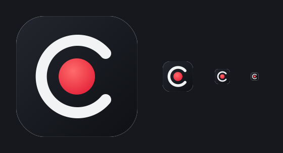

# Cast Recorder

A lightweight Windows screen recorder built for gaming: GPU capture, hardware H.264 encoding, global hotkeys that work in fullscreen games, and a small dark settings window that lives in the tray.



## Features

- **GPU capture**: Windows Graphics Capture (Windows 10 1903+), with DXGI Desktop Duplication as the fallback. Frames stay on the GPU on the hardware path.
- **Hardware encoding** through Media Foundation: NVIDIA NVENC, AMD AMF or Intel QuickSync, with the Microsoft H.264 software encoder as the fallback. *Auto* picks the GPU's encoder.
- **15, 30 or 60 FPS** at a constant frame rate, plus Low, Medium, High and Ultra quality presets (bitrate scales with resolution × FPS and is capped at 150 Mbit/s).
- **Containers**: MP4 natively. MKV and MOV are written by remuxing the MP4 losslessly with `ffmpeg.exe` (`-c copy`) if one sits next to the app or on PATH. Otherwise the recording is kept as MP4 and the app tells you so.
- **Hotkeys you press, not pick**: click the field and press any combination, such as `Alt+V`, `Ctrl+Shift+F9`, `Win+PrtSc` or `Ctrl+Num 5`. The combo shows as you type it. You get a warning for reserved shortcuts (Alt+Tab, Win+L, Win+G and so on), for keys that would block typing, for clashes between the two actions, and when another app already owns the combo (`RegisterHotKey` failed). Esc cancels and Backspace clears. Actions: **Start/stop recording** and **Open recordings folder**.
- **Save folder** defaults to `Videos\Cast Recorder` (`SHGetKnownFolderPath(FOLDERID_Videos)`). You can change it with the native folder picker or reset it to the default.
- **Borderless dark UI**: custom title bar you can drag, minimize and close (close sends the app to the tray), per-monitor DPI v2, DWM shadow and rounded corners on Windows 11.
- **Tray icon** that shows a red dot while recording. Its menu has start/stop, open folder, settings and exit.
- **Settings** save automatically as JSON in `%APPDATA%\Cast Recorder\settings.json`, written atomically.
- **Installer** (Inno Setup) creates the Start menu entry **Cast Recorder**, so it shows up in Windows search. It also offers an optional desktop shortcut and an optional start-with-Windows (tray) entry, and includes an uninstaller.
- Single instance: launching it again brings the window up.

## Why native C++ (Win32 + D3D11 + Media Foundation)

- **Smallest footprint**: a single static exe (about 1–3 MB, no runtime, no VC++ redistributable) that idles at a few MB of RAM with ~0% CPU. Electron would be 150+ MB and keep a browser engine running next to your game.
- **Zero-copy GPU pipeline**: WGC/DXGI textures go straight into Media Foundation's DXGI device manager. The GPU video processor converts BGRA to NV12 and the vendor's hardware MFT encodes, so the CPU never touches pixels.
- **No bundled ffmpeg**: every Windows 10/11 PC already has Media Foundation and the GPU vendors' H.264 MFTs. Bundling ffmpeg would add ~80–130 MB for something the OS already does. ffmpeg is used only if you already have it, for MKV/MOV remuxing.
- Rust was the other option. It is just as light, but the WinRT/MF interop would be the same COM calls through `windows-rs` with a heavier toolchain, so C++ keeps the code closest to the APIs.

## Command line (used by CI)

```
CastRecorder.exe --record 4 --fps 60 --encoder software --container mkv --quality high --out C:\tmp\test.mkv [--allow-synthetic]
CastRecorder.exe --minimized      # start in the tray
```
`--record` runs headless, prints the capture method, encoder, frame counts and file, and exits with 0 on success. `--allow-synthetic` falls back to a generated test pattern if screen capture is unavailable (CI only).

## Build

Windows (Visual Studio 2022, includes WGC via C++/WinRT):
```
cmake -S . -B build -A x64
cmake --build build --config Release
ctest --test-dir build -C Release
iscc /DAppVersion=1.0.0 /DBinDir=..\build\Release installer\CastRecorder.iss   # -> dist\CastRecorder-Setup-1.0.0.exe
```
Linux (unit tests only):
```
cmake -S . -B build && cmake --build build && ctest --test-dir build
```
Cross-compile check with MinGW-w64 (builds the exe with Desktop Duplication only, no WGC):
```
cmake -S . -B build-mingw -DCMAKE_TOOLCHAIN_FILE=cmake-mingw.cmake -DCMAKE_BUILD_TYPE=Release && cmake --build build-mingw
```

### App icon
`res/icon.ico` is compiled into the exe and used for the window, tray and installer. To swap in a new design, run `scripts/update-icon.sh [folder]` (default `/workspace/cast-recorder-icon`), which copies `icon.ico` and the PNGs, then rebuild.

## CI

- `ci.yml`: unit tests on Ubuntu, then on `windows-latest` an MSVC Release build, unit tests and the Inno Setup installer, all uploaded as artifacts. A smoke job records 4 s at 15/30/60 FPS to MP4 and MKV with the software encoder, then checks with `ffprobe` that the file exists, is H.264, lasts at least 2.5 s and has the requested average FPS.
- `release.yml`: on a `v*` tag, builds, tests and attaches the installer and a portable exe to the GitHub Release.

## Known limits

- Captures the **primary monitor** only. Audio isn't recorded yet (video only).
- MKV/MOV need `ffmpeg.exe` (not bundled). Without it you get an MP4.
- The specific-vendor choices (NVENC/AMF/QuickSync) require that vendor's GPU to drive the primary monitor. On hybrid laptops where another GPU drives the display, the app falls back to software and says so. Auto uses whatever hardware encoder the display GPU has.
- The hardware-encoder bitrate uses MF defaults (VBR/CBR depends on the driver). There's no rate-control or GOP tuning UI yet.
- Desktop Duplication (MinGW builds, or when WGC is unavailable) draws the cursor with GDI, so animated or colour-inverting cursors may look slightly different.
- Some `Win+…` combos are reserved by the shell and can't be registered. The app reports this as "In use by another app".
- Exclusive-fullscreen games that bypass DWM may show black frames with WGC/Desktop Duplication. Borderless or windowed fullscreen always works.
- CI runners have no GPU, so the hardware encoders and 60 FPS under game load can only be verified on a real PC.
